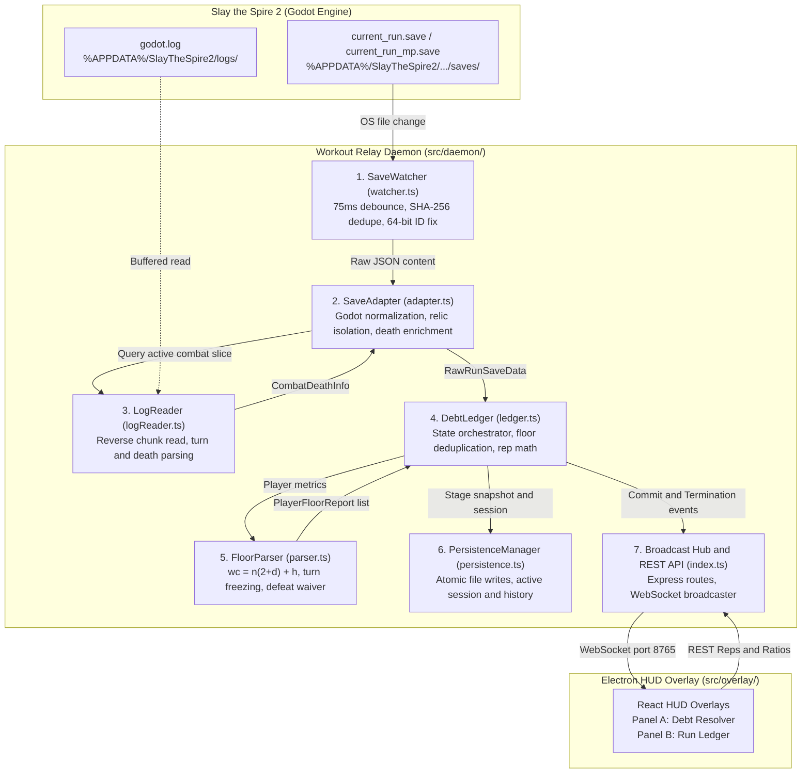
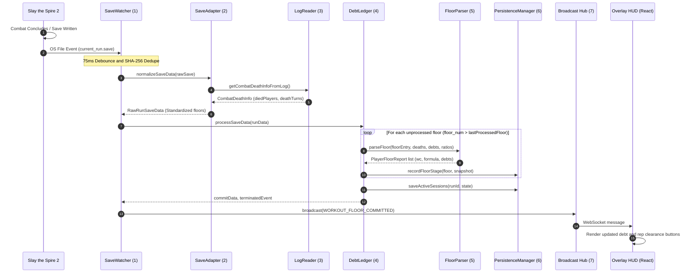

# ⚙️ Slay the Spire 2 Workout Daemon — Component Flow & Architecture

This document provides a comprehensive component-by-component architectural guide to the **Workout Relay Daemon** (`src/daemon/`), illustrating how data flows from native Godot save checkpoints and log files to the authoritative debt ledger, mathematical evaluator, and WebSocket broadcast hub.

---

## 🧭 High-Level Architecture Diagram



---

## 🧩 Component Breakdown & Responsibilities

| # | Subsystem | File Path | Primary Responsibility |
|---|---|---|---|
| **1** | **Save Watcher** | [`src/daemon/watcher.ts`](../src/daemon/watcher.ts) | Observes `%APPDATA%` saves directory using `chokidar`. Debounces disk writes (75ms), performs exponential file-lock retry, SHA-256 hashes content to drop duplicate events, pre-sanitizes 64-bit integer IDs, and delegates parsing to the Save Adapter. |
| **2** | **Save Adapter** | [`src/daemon/adapter.ts`](../src/daemon/adapter.ts) | Normalizes native Godot save dictionaries (`map_point_history`) into standardized `RawRunSaveData`. Chains sequential HP, isolates floor 0 relic self-damage from Weary Traveler, resolves friendly names from `.env`, calls the Combat Log Reader to enrich mid-combat deaths, and delivers standardized data to the Debt Ledger. |
| **3** | **Combat Log Reader** | [`src/daemon/logReader.ts`](../src/daemon/logReader.ts) | Invoked by the Save Adapter. Reads the tail of `godot.log` in reverse chunks (up to 2MB). Extracts player turn numbers (`EndPlayerTurnAction`) and player death timestamps (`Player X died, doing death handling`) to return `CombatDeathInfo` back to the Save Adapter. |
| **4** | **Debt Ledger** | [`src/daemon/ledger.ts`](../src/daemon/ledger.ts) | Authoritative state container. Holds player debts, deaths, squat remainders, squat ratios, and run statuses. Deduplicates floors (`lastProcessedFloor`), processes rep reductions (`CUSTOM_ENTRY`, `ALL_PUSHUPS`, `ALL_SQUATS`), and manages stage history. |
| **5** | **Floor Parser** | [`src/daemon/parser.ts`](../src/daemon/parser.ts) | Pure mathematical calculation engine. Implements $wc_p = n_p(2 + d_p) + h_p$. Freezes turns at the exact round of death, updates death penalties, calculates positive HP loss, and handles defeat combat debt. |
| **6** | **Persistence Manager** | [`src/daemon/persistence.ts`](../src/daemon/persistence.ts) | Crash-proof atomic disk persistence. Writes data to `.tmp` files and renames them synchronously (`fs.renameSync`) to prevent corrupted reads during game crashes or reboots. Manages `active_session.json` and `workout_history.json`. |
| **7** | **Broadcast Hub & REST** | [`src/daemon/index.ts`](../src/daemon/index.ts) | Express HTTP server and WebSocket relay listening on `0.0.0.0:8765`. Handles incoming player actions (`resolve`, `ratio`, `commit-pending`) and broadcasts state events (`RUN_DETECTED`, `WORKOUT_FLOOR_COMMITTED`, `RUN_TERMINATED`, `STATE_UPDATE`). |

---

## 🔍 Deep-Dive: Exactly Where Mid-Combat Death is Checked

Mid-combat death detection is an interconnected pipeline:

### Step 1: Save Adapter Invokes Log Reader ([`src/daemon/adapter.ts#L125-L134`](../src/daemon/adapter.ts#L125-L134))
When [`SaveWatcher`](../src/daemon/watcher.ts) passes raw JSON into `normalizeSaveData()`, the Save Adapter calls:
```typescript
// Save Adapter triggers the Log Reader
logInfo = getCombatDeathInfoFromLog();
```

### Step 2: Log Reader Parses `godot.log` ([`src/daemon/logReader.ts#L22-L65`](../src/daemon/logReader.ts#L22-L65))
The log reader inspects the active combat block inside `godot.log` and returns `CombatDeathInfo`:
```typescript
// 1. Tracks latest combat turn for each player
const turnMatch = line.match(/EndPlayerTurnAction for player (\d+) turn (\d+)/) ||
                  line.match(/NetEndPlayerTurnAction turn:\s*(\d+).*?from (\d+)/);
if (turnMatch) {
  playerLastTurns[pid] = turnNum;
}

// 2. Detects exact round of death
const deathMatch = line.match(/Player (\d+) died, doing death handling/);
if (deathMatch) {
  const deadPid = deathMatch[1];
  diedPlayers.add(deadPid);
  deathTurns[deadPid] = playerLastTurns[deadPid] || maxCombatTurn || 1;
}

return { diedPlayers, deathTurns, playerLastTurns, maxCombatTurn };
```

### Step 3: Save Adapter Enriches Floor Metrics ([`src/daemon/adapter.ts#L225-L274`](../src/daemon/adapter.ts#L225-L274))
The Save Adapter receives `logInfo` and attaches the frozen `death_turn` into the floor metrics:
```typescript
// Checks if the player registered death in godot.log OR by 0 HP in save checkpoint
const isDiedFromLog = isCombat && logInfo && candidateIds.some((id) => logInfo.diedPlayers.has(id));
const isDeadByHp = isCombat && (stat?.current_hp === 0 || hp_end === 0);

const died_this_floor = Boolean(stat?.died || stat?.died_this_floor || isDeadByHp || isDiedFromLog);

// Freezes the turn count at the round of death
const death_turn = died_this_floor
  ? (logDeathTurn ?? stat?.death_turn ?? stat?.turn_died ?? stat?.turns_survived ?? total_combat_turns)
  : null;
```
The Save Adapter returns `RawRunSaveData` to the Save Watcher callback, which delivers it to `DebtLedger.processSaveData()`.

### Step 4: Debt Ledger Calls Floor Parser ([`src/daemon/parser.ts#L24-L40`](../src/daemon/parser.ts#L24-L40))
[`DebtLedger.processSaveData`](../src/daemon/ledger.ts#L139) passes the enriched floor entry to [`FloorParser.parseFloor()`](../src/daemon/parser.ts#L9):
```typescript
// 1. Calculate turns taken (n_p) with turn freezing
let turnsTakenN = 0;
if (!isNonCombat) {
  if (metric.died_this_floor && metric.death_turn !== null && metric.death_turn > 0) {
    turnsTakenN = metric.death_turn; // <-- FROZEN AT ROUND OF DEATH
  } else {
    turnsTakenN = floorEntry.total_combat_turns;
  }
}

// 2. Increment cumulative deaths (d_p)
const newDeathsD = metric.died_this_floor ? currentDeaths + 1 : currentDeaths;
if (metric.died_this_floor) {
  playerDeathCounts.set(idx, newDeathsD);
}

// 3. Compute formula: wc_p = n_p * (2 + d_p) + h_p
const countersAdded = turnsTakenN * (2 + currentDeaths) + hpLostH;
```

---

## 🔄 End-to-End Save Ingestion Sequence



---

## 🗃️ State Containers in `DebtLedger` ([`src/daemon/ledger.ts`](../src/daemon/ledger.ts))

`DebtLedger` maintains the following in-memory maps synchronized with `active_session.json`:

```
DebtLedger
 ├── runId: string                         (e.g., "run_1791595114")
 ├── isMultiplayer: boolean                (true if co-op lobby)
 ├── lastProcessedFloor: number            (e.g., 6)
 ├── playerDebts: Map<number, number>      (0 -> 14 wc, 1 -> 8 wc)
 ├── playerDeaths: Map<number, number>     (0 -> 0 deaths, 1 -> 1 death)
 ├── playerAggregates: Map<number, obj>    (0 -> { accrued: 52, pushups: 38, squats: 0 })
 ├── playerSquatRemainders: Map<number, n> (0 -> 1 remainder when R=3)
 ├── playerSquatRatios: Map<number, n>     (0 -> 3, 1 -> 2)
 ├── activeSessionsMap: Map<string, Store> (Enables switching between SP and MP runs)
 └── pendingFloorEntry: RawFloorEntry?     (Floor held during reward screen)
```
